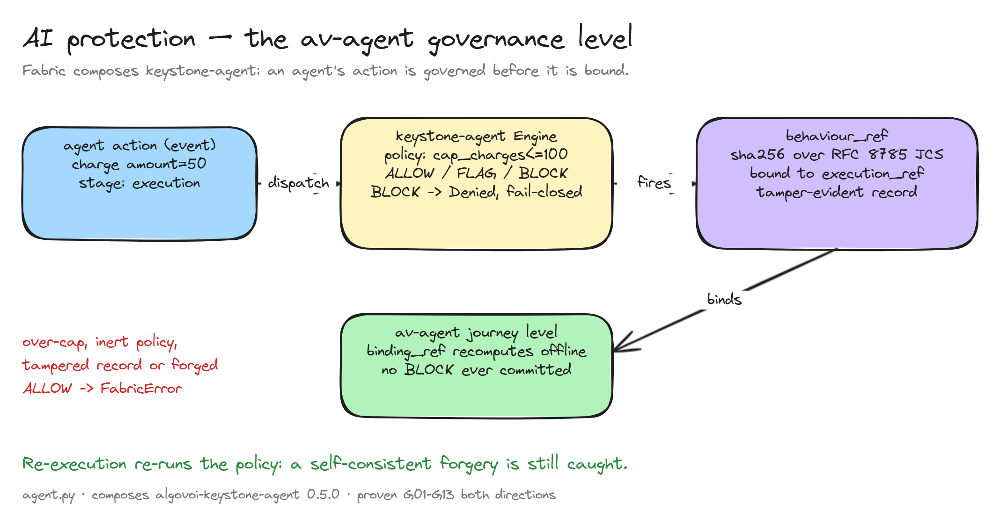

# AlgoVoi Fabric — Architecture: how Keystone sits inside Fabric

**Status:** engineering specification for `algovoi-fabric` 0.4.0.
**Describes:** `src/algovoi_fabric/` (this revision). Every claim
below cites the file and line it rests on; the guarantees are re-proven live by
[`proofs/spine_proof.py`](proofs/spine_proof.py) (61 properties, each proven green
on valid input **and** red on a planted defect) and the 139-test suite
(135 passed, 4 skipped).

---

## 1. The thesis

Fabric is a **composition layer**, not a new verifier and not a new cryptography
implementation. **Keystone is the trust substrate** — the definition of a valid
content reference and the offline verifier that proves a chain recomputes.
Fabric assembles Keystone chains into a start-to-finish agentic-commerce journey
and gates the protocol front-door; it delegates *every* reference and *every*
verification to the published estate primitives.

The dependency is **one-way: Fabric → Keystone.** Fabric imports the estate; the
estate never imports Fabric. There is exactly one definition of "recomputes" in
the whole stack, and it lives in `algovoi-keystone`.

```
                 ┌──────────────────────────────────────────────┐
                 │                  ALGOVOI FABRIC               │
                 │   composition · journey envelope · gate       │
                 │   (Apache-2.0 middleware — no crypto of its   │
                 │    own, no sealing engine, no wire schema)    │
                 └───────────────┬──────────────────────────────┘
                                 │ delegates every ref + every verify
        ┌────────────────────────┼─────────────────────────────────┐
        ▼                        ▼                                  ▼
 algovoi-keystone         algovoi-keystone-connect            algovoi-pef
 _ref / _resolve          keystone_ref (sha256/JCS)           verify_pef
 verify_chain             archive:bind · protocol:face        (AV-PEF frame)
 (AV-RAILS chain)         (AV-VCS binding)
                                 │
                          avm-ac2 / avm-mesh
                          verify_consent (AC2: who approved)
```

## 2. The delegation map

| Fabric surface | Estate primitive it delegates to | Source |
|---|---|---|
| `compose_chain` reference computation | `algovoi_keystone.verify._ref`, `_resolve` | `compose.py:21-26,73-74` |
| `verify` (offline chain check) | `algovoi_keystone.verify.verify_chain` | `compose.py:89-92` |
| AV-RAILS journey level | `verify_chain` via `verify` | `journey.py:125-127,185-187` |
| AV-PEF journey level | `algovoi_pef.verify_pef` | `journey.py:28,143-144,197-198` |
| AV-VCS storage binding | `algovoi_keystone_connect.keystone_ref` over `archive:bind` | `journey.py:27,93-95` |
| Protocol front-door content address | `algovoi_keystone_connect.keystone_ref` | `protocols.py:32,86` |
| AC2 consent verification | `avm_ac2.verify_consent` (re-checks `avm_mesh` seal) | `ac2.py:29,72` |
| AC2 binding content address | `algovoi_keystone_connect.keystone_ref` over `ac2:bind` | `ac2.py:28,51-52` |
| av-agent policy evaluation | `algovoi_keystone_agent.Engine`, `check_guard_coverage` | `agent.py:30-36,126-131` |
| av-agent event identity | `algovoi_keystone_agent.Event.ref` | `agent.py:59-62` |
| av-agent binding content address | `algovoi_keystone_connect.keystone_ref` over `agent:guard` | `agent.py:76-99` |

Every content address in Fabric is `sha256` over **RFC 8785 JCS** canonical
bytes — the estate's single reference primitive. Fabric never canonicalises or
hashes on its own.

## 3. Hardening rule 12 — one definition of "recomputes"

`compose_chain` computes each link's declared `ref` with the verifier's **own**
`_resolve` then `_ref` (`compose.py:73-74`), not a private reimplementation. The
consequence is structural: the chain Fabric emits is accepted by `verify_chain`
**by construction** and cannot drift from the verifier (`compose.py:3-8`). If the
verifier's canonicalisation ever changes, Fabric changes with it automatically,
because there is no second implementation to fall out of sync.

Chain mechanics (`compose.py:36-86`):

- Input is an ordered iterable of `(name, preimage)` pairs.
- A preimage binds an earlier link with the string `"@name"`; `"@@name"` is the
  literal escape for `"@name"` (`compose.py:44-46`).
- `_resolve` substitutes earlier refs and **raises on a forward/unknown
  reference** — fail-closed, never a silent resolve (`compose.py:69-73`).
- Output envelope: `{"schema": "algovoi-keystone-chain/v1", "canon":
  "jcs-rfc8785-v1", "chain": [...]}` plus optional `description` / `assertions`
  (`compose.py:28-29,81-85`).

Structural refusals before any chain is emitted: non-pair link, empty/non-string
name, non-dict preimage, duplicate name (`compose.py:60-68`), and empty chain
(`compose.py:79-80`).

## 4. Trust-boundary Rule K — estate exceptions never escape

A caller of Fabric catches **`FabricError`** (a `ValueError`, `compose.py:32-33`).
Every estate refusal is translated to it at the boundary, so a hostile input can
never leak a raw `KeystoneError`, `MeshError`, `TypeError` or `KeyError` past a
caller's `except FabricError`:

- `compose_chain`: `KeystoneError → FabricError` (`compose.py:77-78`).
- `verify`: `KeystoneError → FabricError` (`compose.py:93-96`).
- `verify_ac2_consent`: `MeshError → FabricError`, **plus an unconditional
  `except Exception` net** so a future `avm-ac2` change cannot leak a new
  exception type (`ac2.py:71-81`).
- `compose_agent_guard` / `verify_agent_guard`: `Denied → FabricError`, plus an
  unconditional `except Exception` net so a hostile event cannot leak a raw
  engine exception (`agent.py:133-138,227-231`).
- `_validate_chain_shape`: a malformed journey chain (string/number `chain`, a
  link missing `name`/`ref`/`preimage`) is refused as `FabricError` rather than
  raising `TypeError`/`KeyError` — the guard that closed a prior fail-open hole
  (`journey.py:51-73`).

`ProtocolError` is a subclass of `FabricError` (`protocols.py:48-49`), so the
protocol gate's refusals are caught by the same `except FabricError`.

> **Caller contract:** catch `FabricError`, not `KeystoneError`. A forward or
> unknown `@ref` in `compose_chain` raises `FabricError` (proven: it is *not* an
> instance of `KeystoneError` — `spine_proof.py` C09).

## 5. The journey — one execution reference anchors every level

`compose_journey` (`journey.py:98-166`) emits a single envelope
(`algovoi-fabric-journey/v1`, `journey.py:33`) whose **execution link ref** is the
anchor for everything downstream:

1. **AV-RAILS** — the chain is verified at compose time, not only at verify time;
   `verify_chain` reports `ok` rather than raising on a ref mismatch, so the `ok`
   flag is asserted explicitly to stay fail-closed (`journey.py:121-127`).
2. **AV-PEF** — the execution preimage must bind the frame via
   `settlement_frame_id == frame["frame_id"]`, and the frame must verify offline
   (`journey.py:140-144`).
3. **AV-VCS** — `archive_binding_ref` feeds the chain's `execution_ref` into
   `keystone_ref({action_type:"archive:bind", execution_ref, doc_hash, entry_id,
   seq})` (`journey.py:93-95,150-156`). This is **byte-identical** to the public
   `algovoi-keystone-archive` bridge, so AV-VCS's Compliance Command Center
   re-verifies a Fabric binding with no vendor in the loop (proven:
   `spine_proof.py` J02). `seq` rejects `bool` (`journey.py:91-92`).
4. **AC2** — the consent is verified fail-closed *before* binding; the block
   carries the sealed receipt so it re-checks offline (`journey.py:158-163`).

`verify_journey` (`journey.py:169-217`) recomputes all levels offline and checks
each anchors to the chain's **own** execution link — never the envelope's claimed
reference:

- chain verifies (`185-187`); `exec_ref` recomputed from the chain must equal the
  envelope's `execution_ref` (`189-191`) — a substituted reference is refused even
  if its binding is recomputed (proven: J04);
- PEF re-verifies and re-binds (`197-201`);
- archive `binding_ref` is **recomputed** from the chain's `exec_ref` and compared
  (`207-212`) — a tampered `doc_hash`/`entry_id`/`seq` breaks it (J03);
- AC2 attestation re-verifies with the same authenticated sender (`214-216`).

A valid journey returns `{"ok": True, "levels": [...], "execution_ref": ...}`.

## 6. The protocol front-door — fail-closed version gate

`protocols.py` is the single source of truth for which agentic-commerce protocol
versions the bundle accepts. The declared matrix (`protocols.py:40-45`):

| Protocol | Proven versions | Provenance |
|---|---|---|
| x402 | `1`, `2` | estate `x402_adapter.py` (v1 `x-payment`, v2 `PAYMENT-SIGNATURE`) |
| ap2 | `0.1` | SD-JWT+kb IntentMandate / CartMandate |
| mpp | `2` | IETF draft payment auth v2 |
| a2a | `0.3`, `1.0.1` | 0.3 pack-proven; 1.0.1 graph-EVIDENCED |

`check_version` raises `ProtocolError` on an unknown protocol or an unsupported
version — distinct, explicit errors (`protocols.py:57-69`). This is the "all
versions" discipline made honest: the bundle covers the specific versions the
estate has **proven** and refuses everything else rather than silently accepting
a shape it cannot verify. Adding a version is a deliberate act that must be backed
by a conformance proof, not a default (`protocols.py:38-39`).

`compose_protocol_chain` (`protocols.py:90-121`) gates the version, content-
addresses the exact message bytes into a `protocol:face` link
(`message_ref = keystone_ref(message)`, `protocols.py:86`), and emits an
`execution` link bound via `@protocol`. The caller **cannot override** the
structural binding: `protocol_ref` and `action_type` are stripped from any
caller-supplied execution preimage (`protocols.py:114-116`, proven P07). The
result is a `compose_chain` output the real verifier accepts and
`compose_journey` can carry.

## 7. AC2 — who approved, never upgraded

`ac2.py` adds the consent seam: `avm-mesh` proves *what settled*, AC2 proves *who
approved*. Every check delegates to `avm_ac2.verify_consent`, which re-verifies
the sealed receipt's LEVEL 1 `content_hash` before reading any claim and checks a
detached Ed25519 signature over the settlement's canonical payload
(`ac2.py:9-15,72`).

The levels are owned by `avm-ac2`; **Fabric never upgrades a level**
(`ac2.py:17-21`):

- `consent_present` — a key signed this settlement (NOT that a human/passkey
  approved);
- `sender_bound` — additionally ties that key to the authenticated transaction
  sender (supplying `expected_sender` promotes the result, `ac2.py:65-67`);
- `consensus_bound` — additionally requires a stake-attested settlement.

Fail-closed guarantees:

- a receipt with no verifying consent (`level == none`) is refused, even with
  `require=False` (`ac2.py:82-84`, proven A04/A05);
- `verify_ac2_attestation` recomputes the binding and **rejects a claimed level
  that exceeds what the bytes earned** (`ac2.py:136-139`, proven A12);
- a `sender_bound` block re-verifies only when the same sender is supplied again;
  omitting it stays fail-closed — **never a silent downgrade**
  (`ac2.py:121-128`, proven A14/A15).

## 8. The post-quantum boundary — the engine is never imported

Falcon-1024 sealing, ML-KEM-1024 authenticated encryption and RFC 3161
timestamping are performed by the customer's **licensed AV-VCS engine**. Fabric
binds the journey to the sealed entry **by content address only** and never
imports the engine (`journey.py:16-20`). The binding is recomputable by anyone
offline; the post-quantum protections themselves belong to AV-VCS and the estate's
higher tiers, not to the Fabric core.

## 9. What Fabric deliberately does not do

- **No cryptography or canonicalisation of its own** — every ref is the estate's
  `keystone_ref`/`_ref`; every verify delegates to the published verifier.
- **No sealing engine** — it binds to the sealed entry, never performs sealing.
- **No invented wire schema** — it binds the caller's message by content address
  and gates the version (`protocols.py:23-25`).
- **No silent trust** — a ref the verifier would reject is refused at compose
  time, not only at verify time (`journey.py:121-127`).

## 9b. AI protection: the av-agent governance level



Fabric composes the published `algovoi-keystone-agent` behaviour layer
(`agent.py:30-36`) so an agent's action is governed **before** it is bound. The
dependency stays one-way: Fabric imports the engine; the engine never imports
Fabric. Fabric adds no crypto and no rule language of its own.

- `compose_agent_guard(event, behaviours, execution_ref=..., stage=...)`
  (`agent.py:100-151`) deploys the policy in an `Engine` bound to the execution
  link, checks `check_guard_coverage` (an inert trigger that can never fire at
  this stage is refused, `agent.py:126-128`), dispatches the event, and refuses a
  `BLOCK` verdict fail-closed (`agent.py:142-143`). A policy that produces no
  firing is refused (`agent.py:140-141`): governance theatre is not protection.
- Every firing is a content-addressed `behaviour_ref` (the engine's own
  `keystone_ref` over the record). The journey block carries the plain records,
  the policy descriptor, the reached verdict and an `agent:guard` `binding_ref`
  (`agent.py:76-99`), so it re-verifies offline with no vendor in the loop.
- `verify_agent_guard` (`agent.py:155-232`) recomputes each `behaviour_ref`
  (tamper-evident), checks each firing is bound to the execution link and to the
  event's own content address (`Event.ref`, `agent.py:59-62`), refuses a `BLOCK`
  or a verdict that does not equal the strongest firing, and recomputes the
  policy and binding refs. Given `behaviours=...` it re-runs the policy and
  compares the governance identity of each firing (`agent.py:221-224`), so a
  self-consistent forged `ALLOW` over an over-cap event is still caught.
- The level is wired into `compose_journey` / `verify_journey` as `av-agent`
  (`journey.py:168-174,228-230`), anchored to the same execution link as AV-PEF,
  AV-VCS and AC2. Every refusal surfaces as `FabricError` (Rule K,
  `agent.py:133-138,227-231`).

What the level proves is owned by keystone-agent, not restated as a stronger
claim here: a binding proves a deployed policy fired on this event and reached
ALLOW/FLAG, NOT that the agent is benign. Fabric never upgrades a verdict and
never binds a BLOCKed action as a committed journey. Proven both directions by
`spine_proof.py` G01-G13 and 22 `tests/test_agent.py` cases, each guard mutation-
tested in isolation.

## 10. Proof

The spine is proven against the **published** packages, not a private fork:
`algovoi-keystone` 0.6.0, `algovoi-pef` 0.1.2, `algovoi-substrate` 0.5.1,
`algovoi-keystone-connect` 0.5.0, `algovoi-keystone-agent` 0.5.0, `avm-ac2` ≥ 0.1.0.

- **[`proofs/spine_proof.py`](proofs/spine_proof.py)** — one command re-proves
  **61 properties, each both directions**: green on valid input, red on a planted
  defect (tamper, forgery, scope-widening, malformed input). A fail-open hole or a
  broken guarantee exits non-zero, so it is usable as a gate. Covers chain core
  (C01-C09, 9 checks), protocol gate (P01-P07, 12 checks: P02 exercises all six
  proven protocol versions), full journey (J01-J09, 11 checks: J03 covers
  doc_hash, entry_id and seq), AC2 (A01-A16, 16) and AI protection (G01-G13, 13),
  61 checks in total.
- **139-test suite** (`tests/`) — 135 passed, 4 skipped placeholders; each protection
  green on valid input and red on a planted defect, with a mutation self-test.
- **Byte-exact contract** — the AV-VCS `binding_ref` is byte-identical to the
  canonical `keystone_ref` `archive:bind` preimage of the public bridge (J02).
- **Clean-room build (VM2)** — the wheel is built from staged source, installed
  into a fresh `python:3.12-slim` container with dependencies from PyPI, and the
  suite + spine proof run against the installed package (135 passed, 4 skipped;
  61/61 properties). The installed-wheel negative control goes red on the planted
  mutant and green on restore.

Run the spine proof against a clean install:

```bash
python proofs/spine_proof.py     # exits 0 only if all 61 properties hold both ways
```

## 11. Source map

| File | Role |
|---|---|
| `src/algovoi_fabric/compose.py` | chain composition + offline verify; Rule K boundary; `FabricError` |
| `src/algovoi_fabric/journey.py` | AV-RAILS → AV-PEF → AV-VCS (+AC2) envelope; `archive:bind`; shape guard |
| `src/algovoi_fabric/protocols.py` | fail-closed protocol-version front-door; `protocol:face` |
| `src/algovoi_fabric/ac2.py` | AC2 consent face; `ac2:bind`; no-upgrade / no-downgrade |
| `src/algovoi_fabric/agent.py` | AI-protection face; composes `keystone-agent`; `agent:guard`; fail-closed BLOCK |
| `src/algovoi_fabric/__init__.py` | public surface; `__version__ = "0.4.0"` |
| `proofs/spine_proof.py` | consolidated both-direction mutation proof (61 properties) |
| `tests/` | 139-test conformance + security-hardening suite |

## Licence

Apache-2.0. Canonicalisation follows RFC 8785 (JCS).