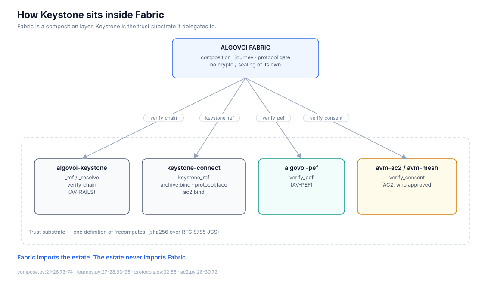
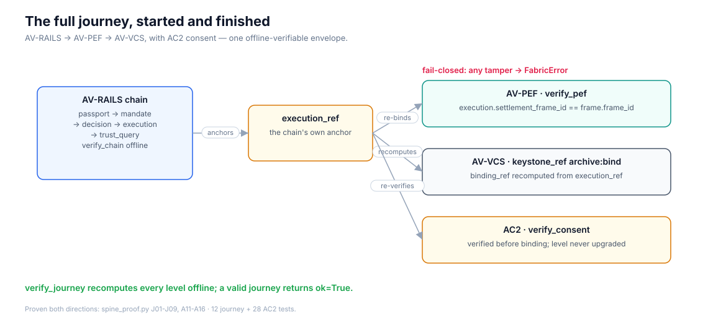
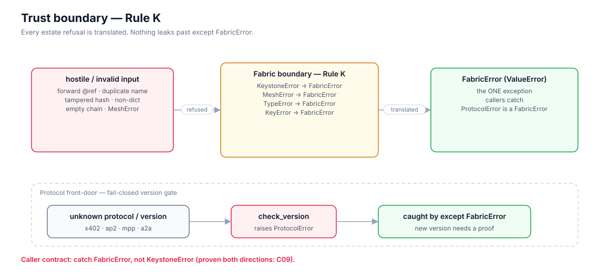
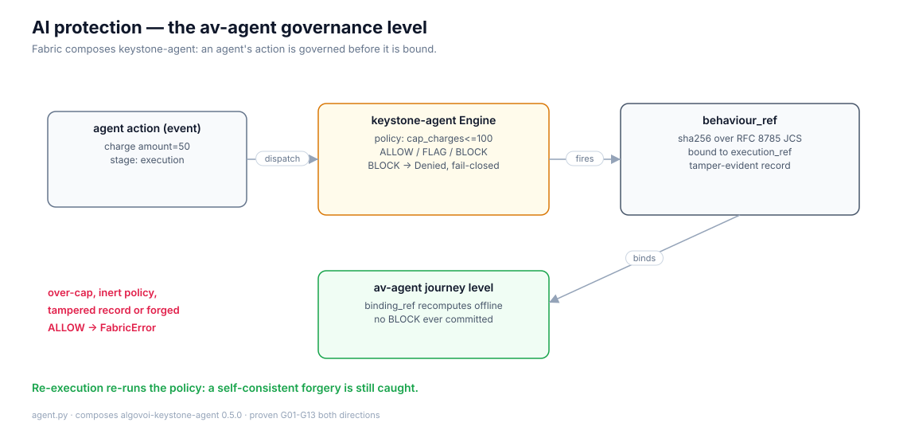

# AlgoVoi Fabric


[](./LICENSE)

**The security composition core for agentic commerce.** Fabric turns an agent's
payment action into a single, tamper-evident, fail-closed, **offline-verifiable**
artefact that spans the whole journey: **AV-RAILS** authority and decision,
**AV-PEF** settlement evidence, and **AV-VCS** sealed-archive binding. The
journey can be started and finished as one recomputable sequence.

The defining guarantee: **every protection is recomputable offline by the
customer: nothing is trusted on AlgoVoi's word.** A plain receipt checker
recomputes one digest; Fabric proves the *whole chain binds in order*, that one
verdict covers it, and that the finished journey is tied to the sealed archive
entry.

> The full-journey composition core is built and proven (see *Proof* below).
> Fabric is a composition layer, not a new protocol: it delegates every
> reference to a published AlgoVoi primitive. The post-quantum sealing and
> timestamping of the archive entry are performed by the customer's licensed
> AV-VCS engine; Fabric binds the journey to that entry and never imports the
> engine.

## The full journey: AV-RAILS -> AV-PEF -> AV-VCS

| Level | Role in the journey | Primitive Fabric delegates to |
|---|---|---|
| AV-RAILS | passport, mandate, policy, decision, execution: the authority chain | `algovoi-keystone` `verify_chain` |
| AV-PEF | the settlement evidence frame bound to the execution | `algovoi-pef` `verify_pef` |
| AV-VCS | the sealed-archive storage binding that finishes the journey | `algovoi-keystone-connect` `keystone_ref` (`archive:bind`) |

`compose_journey` emits one envelope holding the AV-RAILS chain, the AV-PEF
frame and the AV-VCS binding. `verify_journey` recomputes all three offline and
checks that each downstream level anchors to the chain's own execution link.
The AV-VCS `binding_ref` uses the exact `archive:bind` preimage of the public
`algovoi-keystone-archive` bridge, so a binding Fabric emits is accepted by
AV-VCS's Compliance Command Center with no vendor in the loop.

## Design maps

Architecture maps of the composition (editable SVG sources beside each PNG in
[`docs/diagrams/`](docs/diagrams/)):









## Protocol conformance: x402 / AP2 / MPP / A2A

Fabric gates every inbound message against a declared, fail-closed support
matrix before it can enter a chain. The bundle covers the specific spec versions
the estate has proven against the published packages — and refuses everything
else rather than silently accepting a shape it cannot verify:

| Face | Proven versions | Provenance |
|---|---|---|
| x402 | `1`, `2` | estate `x402_adapter.py` (v1 `x-payment`, v2 `PAYMENT-SIGNATURE`) |
| AP2 | `0.1`, `0.2` | 0.1 SD-JWT+kb IntentMandate / CartMandate (estate-proven); 0.2 spine conformance — label bind/verify/journey |
| MPP | `2` | IETF draft payment auth (version 2) |
| A2A | `0.3`, `1.0.1` | 0.3 pack-proven; 1.0.1 graph-EVIDENCED |

`compose_protocol_chain(protocol, version, message)` gates the version,
content-addresses the exact message bytes with `keystone_ref` (sha256 over RFC
8785 JCS), and emits a `protocol` face plus an `execution` link bound to it via
`@protocol` — a `compose_chain` output the real keystone verifier accepts and
that `compose_journey` can carry through AV-RAILS → AV-PEF → AV-VCS. An unknown
protocol or an unproven version raises `ProtocolError` before any link is
emitted, and the caller cannot override the structural binding to the face.

> "All versions" made honest: Fabric pins the versions it has proven and rejects
> the rest. Adding a newly-proven version is a deliberate registry change,
> re-gated by the same conformance suite across both editions.

## Why security is the spine

Companies adopting autonomous agents need assurance they can *verify themselves*,
not a vendor promise. Fabric's chain is content-addressed (`sha256` over RFC 8785
JCS), so tampering any link breaks that link and every link that binds it, and a
customer can recompute the entire chain with no AlgoVoi software in the trust
base and no network contact.

## Protection layers

| Layer | Guarantee | Primitive |
|---|---|---|
| Authority | no permission widening | keystone `scope_subset`, fail-closed |
| Policy | deny-by-default verdicts | compliance gate (ALLOW / REFER / DENY) |
| Integrity | tamper any link → chain breaks | `sha256(JCS)` content addressing |
| Time & revocation | post-revocation actions blocked | `not_revoked` cascade |
| Evidence | settlement bound to the decision | PEF frame (`draft-hopley-x402-payment-evidence-frame`) |
| Archive binding | journey tied to the sealed entry | AV-VCS `archive:bind` via `keystone_ref` |
| Assurance | recomputable offline by the customer | independent `rfc8785` canonicalisation |
| AI protection | agent action governed before binding; BLOCK refused | `algovoi-keystone-agent` Engine (`av-agent`) |
| Consent | who approved the settlement | `avm-ac2` `verify_consent` (AC2) |

## AI protection: the av-agent governance level

Fabric composes the published [`algovoi-keystone-agent`](https://github.com/chopmob-cloud/algovoi-keystone)
behaviour layer so an AI agent's action is **governed before it is bound**. A
deployed policy (spend caps, scope fences, deny lists, required fields) is run
against the action; a `BLOCK` is refused fail-closed, and every governance firing
becomes a content-addressed `behaviour_ref` bound to the journey's execution
link. Fabric adds no crypto: refs delegate to `keystone_ref`, event identity to
`keystone_agent.Event.ref`, and policy evaluation to `keystone_agent.Engine`
(`src/algovoi_fabric/agent.py`).

```python
from algovoi_fabric import compose_journey, verify_journey
from algovoi_keystone_agent import Event
from algovoi_keystone_agent.library import cap_charges

journey = compose_journey(
    chain, execution="execution",
    agent_event=Event("execution", {"action_type": "charge", "amount": 50}),
    agent_behaviours=[cap_charges(100, stage="execution")])
assert "av-agent" in journey["levels"]
assert verify_journey(journey)["ok"]        # offline; governance recomputed

# an over-cap action is BLOCKED and refused before any envelope is emitted:
# compose_journey(..., agent_event=Event("execution", {"amount": 500}), ...)
#   -> FabricError
```

`verify_agent_guard` recomputes every `behaviour_ref` (tamper-evident), checks
each is bound to the execution link and the event's own content address, refuses
a `BLOCK` or a downgraded verdict, and can re-run the policy (`behaviours=...`)
so even a self-consistent forged `ALLOW` is caught. An inert policy (a trigger
that can never fire at the guard's stage) is refused, so governance theatre
cannot pass as protection. Every refusal surfaces as `FabricError` (Rule K).

> **Spend authority vs behaviour.** The av-agent level governs an action against
> a deployed policy (`cap_charges`, `behaviour_ref`). The standalone
> [algovoi-agent-guard](https://github.com/chopmob-cloud/algovoi-agent-guard)
> ([TypeScript](https://github.com/chopmob-cloud/algovoi-agent-guard-ts)) is a
> different primitive: a *human-signed spend mandate* the agent cannot raise,
> with receipts recomputable offline from public material. Fabric does not
> compose it in the core; it is linked here so the two "guards" are not confused.

The post-quantum protections (Falcon-1024 signing, ML-KEM-1024 authenticated
encryption, RFC 3161 timestamping) and BYO-key/KMS/HSM custody belong to the
AV-VCS engine and the estate's higher tiers. Fabric binds the journey to the
sealed entry those protections produce; it does not perform them in the core.

## Proof

The architecture — how Keystone sits inside Fabric as the trust substrate — is
specified in [ARCHITECTURE.md](ARCHITECTURE.md), with every claim cited to source
and re-proven by [`proofs/spine_proof.py`](proofs/spine_proof.py): **61 properties,
each proven green on valid input and red on a planted defect** against the
published packages (one command, usable as a gate).

The core is proven against the **published** packages (`algovoi-keystone` 0.6.0,
`algovoi-pef` 0.1.2, `algovoi-substrate` 0.5.1, `algovoi-keystone-connect` 0.5.0,
`algovoi-keystone-agent` 0.5.0), not a private fork:

- **139 tests** — 135 passed, 4 skipped placeholders: 12 chain core, 12 full
  journey, 37 protocol conformance (4 skipped), 28 AC2 consent, 28 security
  hardening, 22 AI protection (av-agent). Each protection is green on valid input
  and red on a planted defect.
- **Byte-exact contract**: the composer reproduces the published
  `keystone-golden.json` references exactly, and the AV-VCS `binding_ref` is
  byte-identical to the canonical `keystone_ref` `archive:bind` preimage used by
  the public bridge.
- **Mutation self-test**: dropping the composer's ref anchoring turns 3 core
  tests red; dropping the journey's archive-binding recompute turns 3 journey
  tests red; trusting the envelope's claimed execution reference instead of the
  chain's verified one turns 1 journey test red. Restoring returns 24 green,
  bytes identical.
- **Protocol gate mutation**: inverting the version-membership test turns 13
  conformance tests red; restoring returns them green — proven both on the
  source tree and on the *installed* wheel.
- **AI-protection mutation**: each of the 12 av-agent guards (BLOCK refusal,
  inert-policy coverage, no-firing refusal, behaviour_ref / event_ref /
  binding_ref / policy_ref recompute, execution-ref match, verdict==strongest,
  re-execution identity, and both journey wirings) disabled in turn makes its own
  isolating test red; restoring returns 22 green, bytes identical.
- **Clean-room build (VM2)**: the wheel is built from the staged source,
  installed into a fresh `python:3.12-slim` container with dependencies pulled
  from PyPI, and the suite runs against the installed package — 135 passed,
  4 skipped; the spine proof reports 61/61. The installed-wheel negative control
  goes red on the planted mutant and green on restore.
- **Independent review**: Mistral (gating) and Claude (second opinion) both
  return CLEAN; the gating reviewer was first proven to BLOCK a planted
  inverted-version-gate mutant. `bandit` reports no issues.

Proven properties: tamper-evidence; fail-closed on forward/unknown references,
duplicate names and empty chains; scope-widening rejected; revocation cascade
blocks actions after revocation; a PEF settlement frame binds and verifies
offline; the full journey spans AV-RAILS, AV-PEF and AV-VCS and verifies offline;
a tampered archive `doc_hash`, `entry_id` or `seq`, a substituted execution
reference, and an unbound PEF frame are all fail-closed. An unsupported protocol
or version is rejected before any link is emitted, and the protocol face binds
the exact message bytes so tampering breaks offline verification.

## Quickstart

```python
from algovoi_fabric import compose_chain, verify

chain = compose_chain([
    ("passport", {"agent_id": "agent-1", "scope": {"capabilities": ["payments"],
                                                    "max_amount": 1000}}),
    ("decision", {"agent_ref": "@passport", "verdict": "ALLOW",
                  "scope": {"capabilities": ["payments"], "max_amount": 500}}),
    ("execution", {"decision_ref": "@decision", "action_type": "payment",
                   "outcome": "COMMITTED"}),
    ("trust_query", {"subject_refs": ["@passport", "@decision", "@execution"],
                     "trust_outcome": "TRUSTED"}),
], assertions=[{"kind": "scope_subset", "inner": "decision", "outer": "passport"}])

result = verify(chain)   # offline; no issuer contact
assert result.ok and result.capped
```

`@name` binds an earlier link by its computed reference; `@@name` is a literal
escape. A forward or unknown reference raises `FabricError` (fail-closed) — catch
`FabricError`, not `KeystoneError`: the Fabric boundary translates every estate
refusal so nothing leaks past it (trust-boundary Rule K, see
[ARCHITECTURE.md](ARCHITECTURE.md) §4).

The full journey adds the AV-PEF frame and the AV-VCS archive binding:

```python
from algovoi_fabric import compose_journey, verify_journey
from algovoi_pef import build_pef

frame = build_pef(claim_type="payment_settlement", receipt={...},
                  frame_provider_did="did:web:...", frame_timestamp_ms=...)
# the execution link must bind frame["frame_id"] via settlement_frame_id
journey = compose_journey(chain, execution="execution", pef_frame=frame,
                          archive={"doc_hash": "sha256:...",   # sealed entry content address
                                   "entry_id": "entry-0001", "seq": 7})
assert journey["levels"] == ["av-rails", "av-pef", "av-vcs"]
assert verify_journey(journey)["ok"]   # offline; all three levels recomputed
```

`archive` is the attestation from the customer's sealed AV-VCS engine; Fabric
emits the content-addressed `binding_ref` and never performs the sealing itself.

The protocol front-door gates the version and binds the message into the journey:

```python
from algovoi_fabric import compose_protocol_chain, verify, supported_matrix

supported_matrix()
# {'x402': ['1', '2'], 'ap2': ['0.1', '0.2'], 'mpp': ['2'], 'a2a': ['0.3', '1.0.1']}

chain = compose_protocol_chain("x402", "2", {"amount": 250, "currency": "USD"})
assert verify(chain).ok        # offline; the real keystone verifier recomputes it

compose_protocol_chain("x402", "99", {})   # raises ProtocolError (fail-closed)
```

## Links

- Verifier: [algovoi-keystone](https://github.com/chopmob-cloud/algovoi-keystone)
- AI protection: [algovoi-keystone-agent](https://github.com/chopmob-cloud/algovoi-keystone)
- Evidence frame: [algovoi-pef](https://github.com/chopmob-cloud/algovoi-pef)
- AV-VCS: [algovoi-vcs](https://github.com/chopmob-cloud/algovoi-vcs)
- AV-RAILS ↔ AV-VCS bridge: [AlgoVoi-Keystone-Connectors](https://github.com/chopmob-cloud/AlgoVoi-Keystone-Connectors)
- Spend-authority guard: [algovoi-agent-guard](https://github.com/chopmob-cloud/algovoi-agent-guard) ([TypeScript](https://github.com/chopmob-cloud/algovoi-agent-guard-ts)) — human-signed spend mandates with offline-verifiable receipts

## Licence

Apache-2.0. Canonicalisation follows RFC 8785 (JCS).